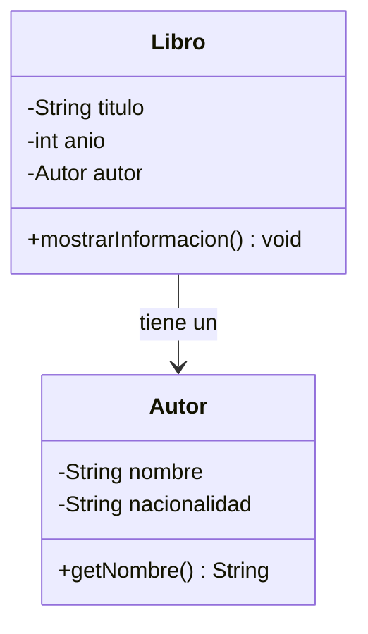
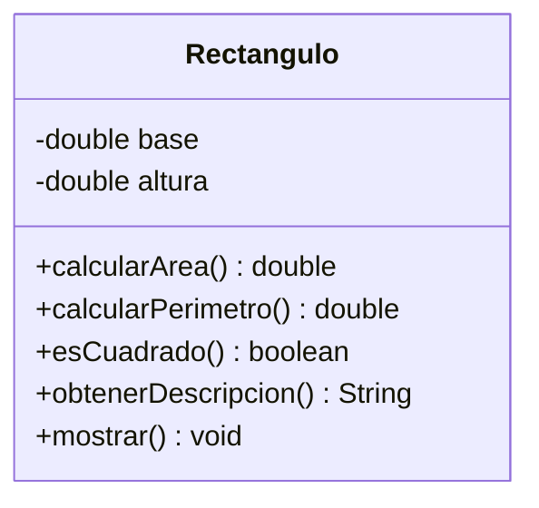
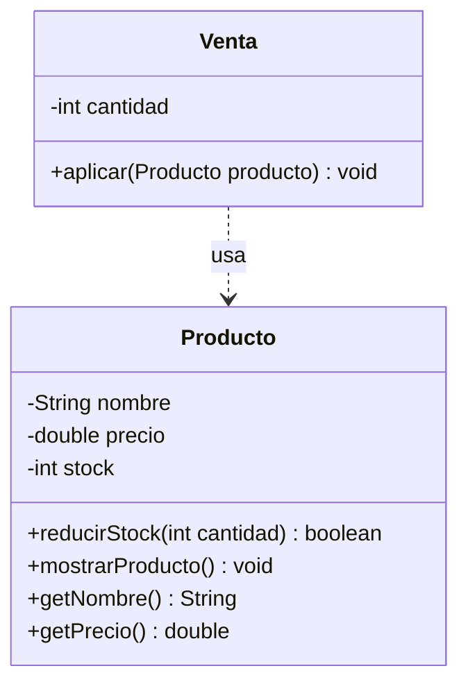
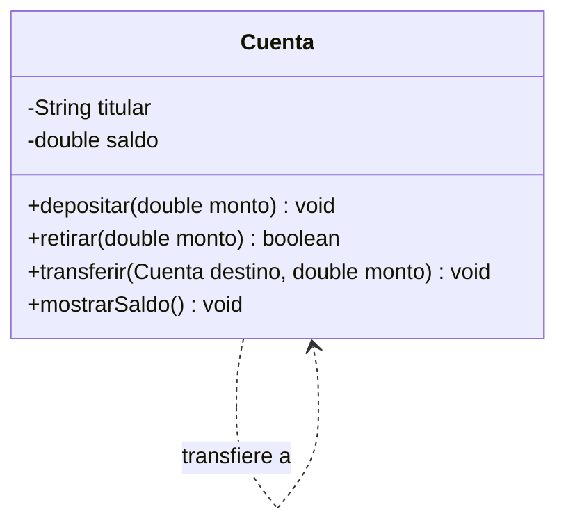
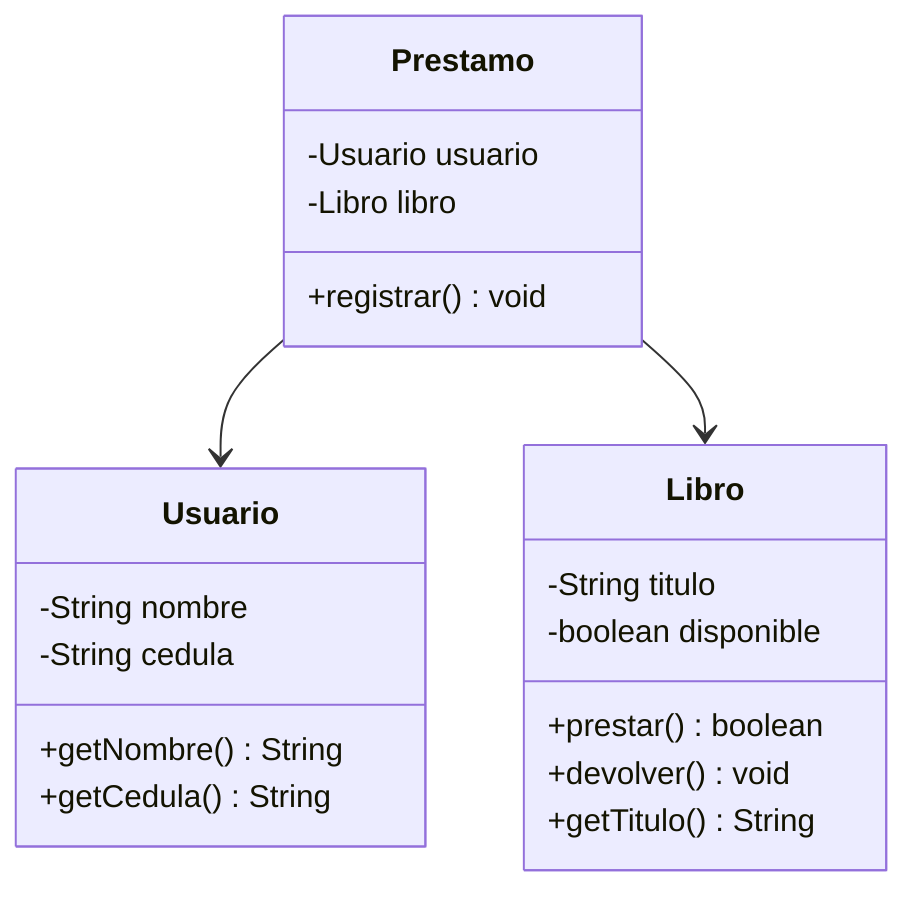

<div align="center">

# 🧩 APE 4: Integración de Clases, Objetos y Métodos

### Ejercicios de práctica en Java


**Algoritmos y Lógica de Programación · Primer Semestre · Paralelo B**

</div>

---

## 📋 Información del proyecto

| | |
|---|---|
| 🎓 **Carrera** | Ingeniería en Software |
| 📚 **Asignatura** | Algoritmos y Lógica de Programación |
| 🏫 **Nivel / Paralelo** | Primer Semestre — Paralelo B |
| 📝 **Actividad** | APE 4 – Integración de clases, objetos y métodos |
| 🧑‍🏫 **Modalidad** | Presencial |
| 👥 **Grupo** | Grupo 3 |

## 👨‍💻 Integrantes

| Integrante |
|---|
| Adrián Andaluz |
| Ariel Chanatasig |
| Paulo Escobar |
| Mateo Salazar |

---

## 📑 Índice

1. [Libro y Autor](#-ejercicio-1-libro-y-autor)
2. [Rectángulo](#-ejercicio-2-rectángulo)
3. [Producto y Venta](#-ejercicio-3-producto-y-venta)
4. [Transferencias](#-ejercicio-4-transferencias)
5. [Biblioteca](#-ejercicio-5-biblioteca)
6. [Cómo ejecutar](#-cómo-ejecutar)

---

## 📚 Ejercicio 1: Libro y Autor

> **Concepto:** Objeto como atributo

### 📝 Enunciado
Crea la clase `Autor` (nombre, nacionalidad) y la clase `Libro` (titulo, anio, autor). `Libro` debe tener un atributo de tipo `Autor` y un método `mostrarInformacion()` que imprima el título, el año y el nombre del autor. En `main`, crea 2 libros.

### 🗺️ Diagrama de clases




</details>

### 🖥️ Salida esperada

```text
Título: Cien años de soledad
Año: 1967
Autor: Gabriel García Márquez
-----------------------
Título: Huasipungo
Año: 1934
Autor: Jorge Icaza
-----------------------
```

---

## 📐 Ejercicio 2: Rectángulo

> **Concepto:** Firmas de métodos y tipos de retorno

### 📝 Enunciado
Crea la clase `Rectangulo` (base, altura) con los siguientes métodos, usando el tipo de retorno correcto en cada firma. `obtenerDescripcion()` devuelve, por ejemplo, *"Rectángulo de 4.0 x 6.0"*, y `mostrar()` imprime todos los resultados.

### 🧾 Firmas

| Método | Retorno |
|---|---|
| `calcularArea()` | `double` |
| `calcularPerimetro()` | `double` |
| `esCuadrado()` | `boolean` |
| `obtenerDescripcion()` | `String` |
| `mostrar()` | `void` |

### 🗺️ Diagrama de clases




</details>

### 🖥️ Salida esperada

```text
Rectángulo de 4.0 x 6.0
Área: 24.0
Perímetro: 20.0
¿Es cuadrado? No
-----------------------
Rectángulo de 5.0 x 5.0
Área: 25.0
Perímetro: 20.0
¿Es cuadrado? Sí
-----------------------
```

---

## 🛒 Ejercicio 3: Producto y Venta

> **Concepto:** Objeto como parámetro

### 📝 Enunciado
Crea la clase `Producto` (nombre, precio, stock) con `reducirStock(int cantidad)`, que solo actúa si hay stock suficiente (si no, imprime *"Stock insuficiente."*), y `mostrarProducto()`. Crea la clase `Venta` (cantidad) con `aplicar(Producto producto)`, que reduzca el stock y muestre el total a pagar, igual que `Cuenta` y `Transaccion`.

### 🗺️ Diagrama de clases




</details>

### 🖥️ Salida esperada

```text
Producto: Laptop | Precio: $750.0 | Stock: 5
Venta realizada: 2 x Laptop
Total a pagar: $1500.0
Producto: Laptop | Precio: $750.0 | Stock: 3
Stock insuficiente.
Producto: Laptop | Precio: $750.0 | Stock: 3
```

---

## 💸 Ejercicio 4: Transferencias

> **Concepto:** Objeto como parámetro

### 📝 Enunciado
Usa la clase `Cuenta` del informe y agrega el método `transferir(Cuenta destino, double monto)`, que retire el monto de la cuenta actual y lo deposite en la cuenta destino **solo si hay fondos**. En `main`, crea 2 cuentas, haz una transferencia válida y otra que falle.

### 🗺️ Diagrama de clases




</details>

### 🖥️ Salida esperada

```text
=== Saldos iniciales ===
Ana -> Saldo: $500.0
Luis -> Saldo: $100.0

=== Transferencia válida ===
Transferencia exitosa de $200.0 de Ana a Luis
Ana -> Saldo: $300.0
Luis -> Saldo: $300.0

=== Transferencia que falla ===
Transferencia fallida: fondos insuficientes en la cuenta de Ana
Ana -> Saldo: $300.0
Luis -> Saldo: $300.0
```

---

## 🏛️ Ejercicio 5: Biblioteca

> **Concepto:** Colaboración entre clases

### 📝 Enunciado
Crea tres clases que colaboren entre sí: `Usuario`, `Libro` y `Prestamo`. `Prestamo` tiene atributos de tipo `Usuario` y `Libro`, y su método `registrar()` intenta prestar el libro y muestra un mensaje según el resultado. En `main`, haz que dos usuarios intenten pedir el mismo libro.

### 🗺️ Diagrama de clases




</details>

### 🖥️ Salida esperada

```text
 Mateo (C.I. 1750000001) se llevó el libro "Don Quijote de la Mancha".
 Ariel no pudo llevarse "Don Quijote de la Mancha": ya está prestado.
```

---


